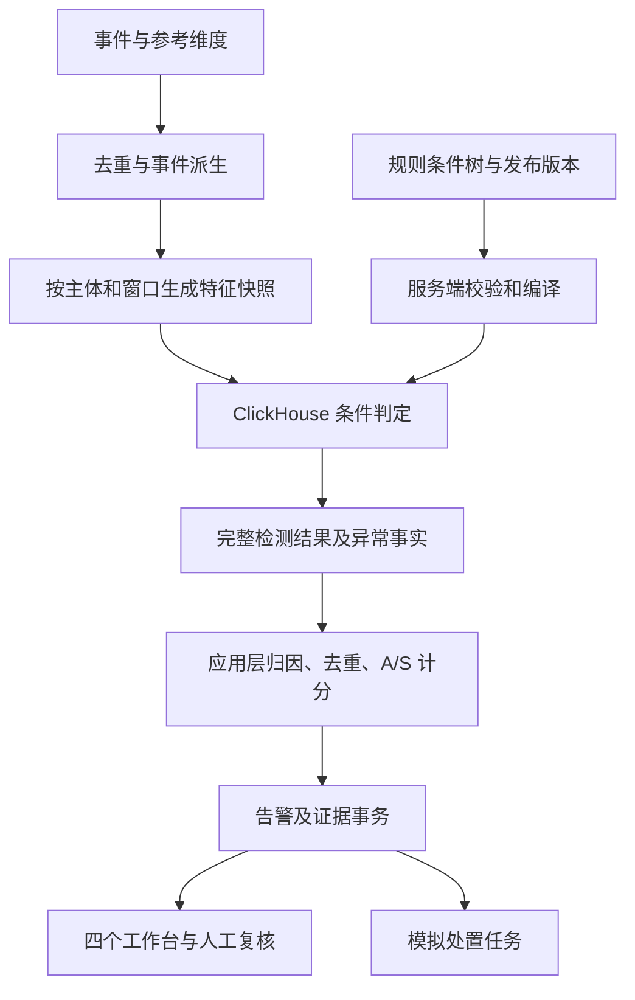

# TraceGuard 实现方案

版本：v1.0（实施设计稿）

日期：2026-10-23

范围：从现有验证数据和特征 SQL，形成风险大盘、告警复核、主体计分卡、规则配置与回放的可演示闭环。

## 1. 实施结论与依据

采用“ClickHouse 提取特征及判断数值条件，应用层管理异常事实、主体归因、双分计分和告警”的架构。规则编辑器维护受限条件树，服务端校验后编译；不引入独立规则引擎服务。

计分依据为 [计分卡 v0.2](计分卡-v0.2.md)，数据语义依据为 [基础表与聚合特征抽取说明](基础表与聚合特征抽取说明.md)、[验证数据契约](验证数据契约.md) 和 [特征提取 SQL 编号对照](特征提取SQL编号对照.md)，页面以 [交互原型](TraceGuard-交互原型.html) 为基准。

本方案替代旧方案中的以下设计：

- 六元组动态评分、单总分、L1～L4 分级，改为规则最高档、A/S 双分及 v0.2 等级。
- 两个速度阈值同时加分，改为同一事实只保留最高档。
- 全部规则读取同一张十分钟宽表，改为按自然主体和规则窗口保存特征快照。
- 每分钟重新扫描全部原始事件，改为可复用事件层、按依赖抽取和可检查点恢复的任务。
- 高等级直接自动吊销 token，改为告警复核与独立处置流程；首期仅模拟处置。

以下新增表、接口、字段和调度机制均为待实施设计，本文不表示已创建数据库对象或实现服务。

## 2. 当前基础与首期范围

### 2.1 已有能力

| 项目 | 当前状态 |
| --- | --- |
| 六张 `da.tg_validation_*` 基础表 | 已在测试 ClickHouse 存在，承担事件和参考维度 |
| `events_dedup`、`event_features` | 普通视图，负责去重及事件派生；不是已持久化的特征结果 |
| TG-F00～TG-F12 | 按参数窗口执行的只读特征 SQL，输出粒度不同 |
| Python 工具 | 数据生成、导入、查询、文件导出和固定样例验证 |
| 交互原型 | 四个工作台，本地演示数据、计分、复核与版本保存 |
| 规则执行、聚合结果持久化、告警 API | 待实现 |

2026-10-23 的只读检查确认：事件表逻辑记录 1,094,841 条，其中一条为明确采集重放，业务事件去重后 1,094,840 条。主验证范围为北京时间 `[2026-10-16 00:00:00,2026-10-24 00:00:00)`；另有历史验收样例。

这些数据主要是合成验证数据，包含 986 条脱敏参考事件，不代表真实生产风险分布。本轮重新验收已执行 15 个样例，13 个通过、2 个连接中断，其余尚未执行完；不能沿用历史报告直接宣称当前版本全部通过。

### 2.2 首期交付边界

首期交付四个工作台、规则版本、特征快照、异常事实、A/S 双分、人工复核、查询导出和单策略回放。接入当前测试批次，并明确展示数据类别、覆盖范围及缺失能力。

实施顺序先打通 R7、R9，再接入 R2、R4B、R10，随后扩展 R1、R3、R4A、R5、R6、R8。进入页面的每条规则都必须通过自身特征和业务前提验收；尚未满足条件时显示“未启用/数据不足”，不使用虚构分数补齐。

AI 起草、AI 日报、生产自动处置及在线毫秒级拦截属于扩展项。首期可保留入口说明，但不能把本地模拟标为真实执行。

## 3. 模块职责与技术组合

默认采用一个 TraceGuard 后端进程：TypeScript/Node.js，ClickHouse 23.2.2.20 承担分析查询，MySQL 8 承担版本、任务和告警事务。当前仓库没有服务端工程，新增模块统一放在这个应用中；以后接入公司服务体系时再映射部署归属。

前端沿用现有原型的布局和交互，数据访问替换为后端 API。现有条件表单可先复用；需要嵌套 AND/OR 时再引入 react-querybuilder 组件。后端始终采用项目自己的受限规则契约，编辑器组件不决定业务评分语义。依赖版本在实现时写入锁文件。

| 模块 | 职责 |
| --- | --- |
| 特征注册与抽取 | 字段定义、窗口、数据质量、抽取依赖、快照生成及查询限额 |
| 规则配置与发布 | 草稿、服务端校验、SQL 预览、样例回放、发布和回滚 |
| 检测执行 | 固定窗口与版本、编译条件、执行规则、记录完整检测结果 |
| 事实与计分 | 活动上下文、异常片段、主体归因、准入、去重、分组封顶及反复加分 |
| 告警与复核 | 告警聚合、通知抑制、证据快照、负责人、复核记录及模拟处置 |
| 回放与展示 | 历史任务、版本差异、计分卡、趋势、详情及导出 |



“不另建求值服务”不意味着所有逻辑必须压成一条 SQL。集合、区间与数值条件在 ClickHouse 计算；跨窗口事实管理、归因和事务状态由应用层处理。

## 4. 特征输入与快照契约

### 4.1 数据范围和时间

一次抽取必须固定以下输入，不允许由编辑器任意覆盖租户或表名：

| 输入 | 含义 |
| --- | --- |
| `tenant_id` | 从认证权限确定，对应当前验证表的 `user_id` |
| `dataset_scope` | `run_id`、明确的场景集合、数据类别集合及来源范围 |
| `window_start/window_end` | 主统计事件时间窗口，采用 `[start,end)` |
| `ingest_cutoff` | 本次允许使用的采集入库截止时间 |
| `feature_version` | SQL、解析器及派生算法的版本清单 |
| `reference_version` | 媒体、授权、覆盖、业务配置和 IP 映射的版本清单 |
| `extracted_at` | 实际抽取完成时间，不代替事件时间或入库截止时间 |

补充 SQL/查询适配器的场景集合和 `dataset_kind` 筛选能力；在全部入口完成之前，只允许显式登记的验证场景，禁止默认整批混跑。相同筛选作用于主窗口、前态和历史基线。

历史复现时，在事件去重选择之前应用 `ingest_time <= ingest_cutoff`，再从截止时点已知的记录中选版本。现有普通去重视图反映当前已知数据，不能直接承担任意历史截止时点查询。若物理表已覆盖或合并掉历史修订记录，需要保存不可变事件修订或冻结输入；缺少这些材料时只能做事后重算。

### 4.2 快照标识和自然粒度

一个特征组保留自身自然粒度。统一信封不代表将所有组强行并成同一粒度宽表。

```text
FeatureSnapshot
  snapshot_id, generation_id
  tenant_id, dataset_scope_id
  feature_group, feature_version, reference_version
  subject_type, subject_id
  context_type, context_key, context_dimensions
  window_start, window_end, ingest_cutoff, extracted_at
  values
  field_quality { field: {status, reason, value_kind, evidence_ref} }
  numerators, denominators, unknown_counts
  evidence_refs, input_digest
```

`context_dimensions` 保留视频、token、会话、媒体序列、来源、阶段及采样等该组必需维度，先按确定规则规范化，再生成上下文标识。`snapshot_id` 由数据范围、组版本、主体、上下文、窗口和抽取代次生成；重试相同代次得到相同标识。哈希索引之外保留完整规范化键，发生冲突时拒绝合并。

分别保存个人跨视频、个人视频局部、视频整体、token 及会话结果。合并到目标主体之前必须经过注册的归并函数，不允许一对多结果直接 JOIN。

### 4.3 质量和规则三值结果

字段状态至少支持 `AVAILABLE / PARTIAL / UNAVAILABLE`；值性质至少支持 `OBSERVED / LOWER_BOUND / ESTIMATED`。是否可进入具体规则，由该规则的字段契约决定。

- 0 表示在既定范围与可计算条件下得到零；NULL 表示未知，保留原因。
- 组级 `AVAILABLE` 不能覆盖字段级缺失；无输出行也不能自动补零。
- 对正向、单调的数量门槛，只有显式登记的规则允许使用已观测下界；下界不能证明“没有访问”“全部失败”或“覆盖完整”。
- 用期望来源及事件类型清单生成质量检查骨架。TG-F00 当前从已有事件出发，完全没有记录的类型也应产出 `NO_OBSERVATION`，并结合覆盖登记区分零活动和未知采集状态。
- 条件判断采用 TRUE/FALSE/UNKNOWN。AND 中存在 FALSE 则为 FALSE，否则有 UNKNOWN 则为 UNKNOWN；OR 中存在 TRUE 则为 TRUE，否则有 UNKNOWN 则为 UNKNOWN。

一条规则按档位从高到低判断。确定命中的最高档形成已证明分值；更高档存在未知条件时标记结果不完整，不把未知条件视为失败。只有规则契约明确允许已证明下界时才计该分，且主体卡同时列出缺失项；没有可计分依据时显示“—”。SQL 执行失败记为 `ERROR`，不能改写成业务不命中。

### 4.4 持久化选择

ClickHouse 新增设计中的 `tg_feature_fXX` 结果表，按特征组保存类型明确的列及公共信封；确需拆分粒度时使用组内子表。复杂证据明细另存，结果表只保留引用和有界摘要。用于复现的代次快照保持不可变。

MySQL 的抽取代次记录承担发布清单：全部必需分片写入、行数及质量校验通过后才标记 `COMPLETE`。检测任务只读取某个完整代次，并在查询中明确限定该代次和版本；不依赖 ClickHouse 后台合并来实现事务可见性，也不只凭插入成功就发布结果。

对同代次重复插入，使用稳定行键、完成清单和明确的去重读取约定；ReplacingMergeTree 等实现必须验证后台合并前的逻辑幂等。事件纠正产生新代次，由清单选择当前版本，历史告警保留原引用。

## 5. 规则字段映射及现有 SQL 补齐

注册表每个字段记录：稳定编号、物理来源、类型、单位、自然主体、上下文、窗口、字段状态、允许的值性质、业务前提、版本和证据要求。规则编辑器只展示适用字段。

| 规则 | 窗口 | 对应特征与映射 | 进入规则前的要求 |
| --- | --- | --- | --- |
| R1 授权链路 | 10 分钟 | TG-F02；必要步骤缺失和获准分片 | 完整回溯与协议前提；补不同分片计数及同一分片缺失组合，不能用请求数或组级缺失数代替 |
| R2 拉片速度 | 10 分钟 | TG-F03；`content_seconds`、`speed_ratio` 映射到同一结果层的唯一媒体量及固定窗口倍率 | 显式选择 AUTH_PASS 或 CDN 响应；媒体映射与窗口合格；两种结果层分开报告，同速度事实取最高档 |
| R3 多视频并发 | 5 分钟 | TG-F04；增加持续时间合格的 `concurrent_videos` | 可信状态、身份、业务多路策略；请求代理单独展示，不冒充状态并发 |
| R4A 范围外复用 | 30 分钟 | TG-F05；尝试次数、目标视频集合、范围外通过/传输证据 | 当时授权范围和结果已知；按阶段处理，同一请求跨阶段不重复累加 |
| R4B token 多环境 | 10 分钟 | TG-F06；环境合格计数、满足条件的环境组合与交错证据 | token 当时有效；可信 IP/客户端差异、交错内通过数、合法共享策略；增加组合级证据 |
| R5 环境变化 | 60 分钟 | TG-F07；有效事件数、IP/客户端类别、切换 | 明确定义有效事件，保持 VIEWER 与 CREDENTIAL_VIEWER 分离；补业务代理排除依据 |
| R6 分片规律 | 10 分钟 | TG-F08；不同分片、覆盖率、递增比、CV | 完整序列、同清单/轨道/清晰度、非零分母和字段级状态 |
| R7 视频失败 | 10 分钟 | TG-F09；已知结果数、失败数、失败率 | 固定来源和鉴权阶段，UNKNOWN 单列；只进入 A |
| R8 长时访问 | 24 小时 | TG-F10；活跃分钟 M、唯一媒体秒数 C | 完整分钟对齐窗口、完整访问及媒体映射；跨来源不能直接相加唯一内容量 |
| R9 夜间标签 | 事件级；按需聚合 | TG-F01 标签、TG-F11 夜间解释与历史基线 | 有效业务配置、可比历史及覆盖；固定 0 分 |
| R10 工具特征 | 10 分钟 | TG-F12；同工具签名的事件数和阶段数 | 排除后端 UA 与合法工具；补按工具签名分组，不能把不同工具拼成一条高档事实 |

### 5.1 R3：输出能证明持续并发的字段

现有 `playback_state_concurrent_video_count` 是瞬时最大值；`playback_state_overlap_seconds` 是并发数至少为 2 的累计时间。两者不能合起来证明三路持续 60 秒。

本设计候选口径采用：存在同一组 k 个视频，在同一连续区间共同处于可信活跃状态至少 60 秒。需要在规则注册版本中明确 `duration_mode=CONTIGUOUS`，并与计分卡文字一同发布；该解释尚不属于已完成生产校准的结论。

新增按 k 输出的 `longest_common_overlap_seconds`、共同视频集合、起止时间及状态证据引用，取满足持续条件的最大 k 作为规则输入。保留累计时间作为解释字段，不混用。仅“并发数始终不少于 k、但参与视频不断更替”也需要检查同一集合是否满足条件。

反例必须验收：两路重叠 120 秒，第三路只出现 1 秒，应得到合格 K=2，不能按 K=3 计分。

### 5.2 R4B：在同一环境组合内验证全部门槛

现有环境首末观测跨度重叠不是完整交错证明，现有统计也没有直接完成全部 token 有效性和业务策略检查。

新增组合证据：参与环境及 IP/客户端类别、时间序列、确定的切换、有效事件范围、窗口内和交错范围内各环境通过数、时间并列未知量，以及 token 历史有效性。分别实现“至少三个环境各通过五次”和“两种明显不同环境反复交错”的路径。

同一个高档判断的 IP 差异、客户端差异、跨度和通过次数必须来自同一对合格环境，不能分别从多对环境取最大值拼接。时间并列不按 event_id 伪造先后；来源字段、合法代理或共享策略未核实时保持缺失状态。

### 5.3 其余补齐约束

- R1：顺序模型缺失的字段仍不可计算；为缺步骤档位补充去重分片及事件级联合条件，避免不同请求各缺一步被拼成同一高档事实。
- R4A：保留目标视频和阶段证据；token 级低中档跨视频统计不能直接投射成每个视频的分数。
- R8：按媒体区间合并不同来源的重复内容，或固定一个覆盖明确的来源；不能直接相加各来源 C。
- R10：同工具签名内计算阶段和次数，明确哪些阶段相互独立；同请求的鉴权和响应不能任意充当两个下载步骤。
- 维度校验：媒体与业务配置匹配必须唯一；授权快照同生效时点的冲突需要版本序号或拒绝输入，不能依赖数组顺序任意选取。

## 6. 规则契约、编译与发布

### 6.1 规则结构

业务规则使用稳定的 `rule_id`；阈值修改增加版本，不创建第二条相同速度事实来叠加分数。一个规则包含多个档位。

```json
{
  "rule_id": "R2",
  "rule_version": 1,
  "subject_scope": "VIEWER_ALL_VIDEOS",
  "window_seconds": 600,
  "feature_contract": "TG-F03.AUTH_UNIQUE.v1",
  "prerequisites": ["trusted_identity", "media_mapping", "download_policy_checked"],
  "tiers": [
    {"level": "GENERAL", "score": 10, "condition": {"and": [{"field": "content_seconds", "op": ">=", "value": 1800}, {"field": "speed_ratio", "op": ">=", "value": 3}]}},
    {"level": "ATTENTION", "score": 25, "condition": {"and": [{"field": "content_seconds", "op": ">=", "value": 1800}, {"field": "speed_ratio", "op": ">=", "value": 5}]}},
    {"level": "HIGH", "score": 50, "condition": {"and": [{"field": "content_seconds", "op": ">=", "value": 1800}, {"field": "speed_ratio", "op": ">=", "value": 10}]}}
  ]
}
```

以上只是条件结构示例。数据完整性、合法下载策略等前提由可信业务输入提供，不允许通过修改上述阈值跳过。规则 UI 将组件自己的 JSON 转换到该契约；数据库只保存服务端验证过的规范化版本。

### 6.2 服务端校验与编译

服务端按注册表检查主体、窗口、字段、操作符、值类型及范围。首期只支持 AND/OR、比较和枚举 IN；拒绝空条件、未知节点、未支持函数、任意表达式和超出配置上限的嵌套/列表。UI 提交的租户、SQL、表名及字段名不能直接用于执行。

字段映射成服务端固定标识符，值转换为 ClickHouse 带类型参数；来源、租户、代次、窗口和行数限额由执行器强制注入。部署时使用专用分析账号及必要的只读/结果写入权限，凭据通过受控配置注入，不写进方案、规则或前端。

react-querybuilder 负责条件编辑和辅助预览，不作为最终校验器。其解析/导出可能丢弃非法规则，SQL 默认回退表达式可能为 `(1 = 1)`；必须在调用前完成整树校验，并拒绝任何节点丢失、空树或回退结果。AI 首期优先输出受限 JSON 草稿，不接受其 SQL 直接执行。

执行产物包括：规范化条件树、编译器版本、绑定参数类型、SQL 摘要、特征契约版本及质量检查。一个版本的条件、参数和摘要保持可追溯。

SQL 输出所有受检快照的 `MATCH / NO_MATCH / UNAVAILABLE / PARTIAL / ERROR`、最高确定档位、未知档位、质量原因、快照引用及证据引用。不能仅使用 `WHERE level != ''` 丢掉不命中和未知行；它们用于解释、回放和差异统计。

同主体、同快照表、同窗口且字段兼容的规则可以批量编译执行；跨主体或窗口拆开调度。SQL 只读取完成的快照，不在规则执行阶段再次展开原始事件视图。

### 6.3 版本与回滚

状态流转：`DRAFT → VALIDATED → REPLAYED → PUBLISHED → RETIRED`。演示期间的发布角色可以是同一人，但服务端仍检查校验和回放结果。每个任务领取时冻结策略、规则、字段契约、编译器及计分卡版本，中途不切换。

发布通过 MySQL 事务切换当前版本指针。回滚是新建发布记录，重新指向兼容的历史版本；历史告警与计分记录保持原版本。字段版本不兼容时拒绝发布或回滚，先生成对应快照。

“一分钟更新”指后续领取的任务采用新版本；不承诺旧任务瞬间重算，也不改写旧告警。

## 7. 异常事实、主体归因与双分

### 7.1 三种对象分别管理

| 对象 | 作用 | 幂等或合并依据 |
| --- | --- | --- |
| 检测结果 | 某版本在某个特征快照上的判定 | 任务模式、策略/规则版本、快照 ID |
| 异常事实/片段 | 一项可解释的活动证据及其持续过程 | 特征类型、原生主体、活动上下文、证据重叠与时间关系 |
| 告警 | 面向运营的待办及通知聚合 | 租户、目标主体、策略族、异常片段与通知策略 |

重试和滑动窗口重复命中不能形成新的独立异常次数。事实不能仅用“主体＋十分钟桶”标识，也不能仅凭共享 event_id 合并不同特征。保存稳定片段 ID、每次检测关系和不可变证据修订，更新时采用事务锁或乐观版本控制。

相同活动中的速度、序列、工具可以是独立特征；R4B 与同一环境事实的 R5 需要关联为同一事实。活动关联应有会话、token/视频上下文及可信身份依据，不能只因同账号在一天内都出现而关联。

### 7.2 归因与准入

- `VIEWER`、`CREDENTIAL_VIEWER`、未知身份分别处理。只有绑定 viewer 的 token 风险列为关联凭证风险，不能直接计入本人行为 A/S。
- 视频使用视频局部证据；个人跨视频 R2 倍率不复制到每个视频，视频 R7 失败分不复制给观众。
- token 保留内部原生风险主体；原型没有独立 token 计分卡 Tab 不影响内部事实计算及详情展示。
- 进入 S 前逐项检查嫌疑方向、目标主体、合法业务例外及上下文。R7 只进入 A，R9 固定为 0。
- R5/R6/R8/R10 只有与已准入主要嫌疑证据属于同一活动上下文时才进入 S；单独命中可进入适用的 A。

### 7.3 计分顺序与公式

1. 每条规则在一个检测结果中只取最高确定档位。
2. 按目标主体重新做归因与准入；A 与 S 分别形成事实集合。
3. 同事实取最高分，再对每个规则/特征取最近 24 小时最高分。
4. 不同特征在组内相加并封顶，最后计算反复加分和总分。

| 组 | 规则 | 上限 | 用途 |
| --- | --- | ---: | --- |
| G1 授权保护 | R1、R4A | 60 | A，以及准入后的 S |
| G2 内容拉取 | R2、R6、R8 | 60 | A，以及准入后的 S |
| G3 多路/多环境 | R3、R4B、R5 | 60 | A，以及准入后的 S |
| G4 客户端 | R10 | 15 | A，以及准入后的 S |
| G5 访问故障 | R7 | 50 | 仅 A |

```text
A = min(100, A_G1 + A_G2 + A_G3 + A_G4 + A_G5 + B_A)
S = min(100, S_G1 + S_G2 + S_G3 + S_G4 + B_S)
```

0 为无可计分命中；1～24 为一般；25～49 为注意；50～100 为高危险。不存在可计算或可归因依据时为 NULL，页面显示“—/数据不足”，不能用 0 代替。部分规则缺失但仍有可计分事实时展示已证明分数，并列出缺失规则和质量状态，不宣称覆盖完整。

反复加分按 v0.2：同类主要证据的独立片段数为 0～1/2/3/≥4 时，加 0/5/10/15 分。片段须无共享支撑事件、时间不重叠，且中间至少 30 分钟没有该类新异常；缺采或采样空白不算已停止。各主要证据类型分别统计后取最多的一类，全主体最多 15 分。首期若无法证明片段独立性，记录 `repeat_status=UNAVAILABLE`，不授予该附加分。

结果保存最近 24 小时画像、每组贡献、贡献事实、缺失项、归因依据、证据状态及版本。主要规则达到 50 分可单独进入高危险；等级不是盗版概率或内容已传播的证明。

## 8. 存储对象及事务约束

### 8.1 ClickHouse

| 设计对象 | 内容与约束 |
| --- | --- |
| 现有六表与公共视图 | 保留验证输入；新增读取适配器和质量校验 |
| `tg_event_features_v1` | 按需持久化的事件派生层；保留数据范围、事件身份、版本及来源，不把普通视图重命名后当作已物化 |
| `tg_feature_fXX` | 各组自然粒度快照，保存字段质量及输入/参考版本 |
| `tg_detection_results` | 完整规则判定，包括不命中与不可计算结果、模式和版本 |
| `tg_evidence_details` | 有界分片或可定位明细；大列表分页引用，不写进单条告警 JSON |

具体排序键、分区、去重读取及 TTL 在建表前用实际数据验证。先按租户、版本、窗口及上下文读取模式设计，结果保存周期必须覆盖回放期和证据承诺；引用数据过期后页面明确显示证据已过期。当前没有完整性能基线，不给出未经验证的分钟级容量承诺。

### 8.2 MySQL

| 设计对象 | 主要字段及唯一约束 |
| --- | --- |
| `tg_feature_generations` | 范围、窗口、截止、版本、分片清单、状态；抽取请求幂等键唯一 |
| `tg_policy_versions` | 不可变规则 JSON、依赖、编译摘要、回放结果、发布信息；策略 ID＋版本唯一 |
| `tg_policy_publications` | 当前指针、生效时间、操作者、回滚来源；切换指针时校验并发版本 |
| `tg_detection_runs` | LIVE/REPLAY/SHADOW、窗口、输入代次、固定版本、检查点、租约、错误；任务幂等键唯一 |
| `tg_facts`、`tg_fact_revisions` | 稳定片段标识、类型、原生主体、上下文、时间与不可变证据修订；检测结果关联唯一 |
| `tg_subject_scores` | 主体、评分时点、计分版本、输入事实摘要、A/S、分组、缺失项；同一评分输入幂等 |
| `tg_alerts`、`tg_alert_evidence` | 告警状态、初始/最新/峰值评分及各自证据引用；告警与检测结果关联唯一 |
| `tg_review_logs` | 追加式复核状态、依据、操作者、时间、请求幂等键 |
| `tg_list_entries` | 租户、主体类型、匹配范围、有效期、白/灰名单、理由及版本 |
| `tg_action_tasks`、`tg_outbox` | 处置目标/动作/授权依据/幂等键；待执行、成功、失败和回执 |

ClickHouse 和 MySQL 不做跨库分布式事务：先发布完整特征代次，再执行规则，最后由应用事务写入事实、评分、告警及 outbox。跨库中断从持久化任务检查点恢复，同一结果重复消费不重复产生副作用。

## 9. 分钟调度、迟到与性能

### 9.1 时间窗口与检查点

调度目标为每分钟产生待检测任务。默认候选延迟为 2 分钟：`evaluation_end=floor_to_minute(now)-2min`；最终值根据 TG-F00 的来源延迟分布和采集协议调整，不把等待两分钟视为日志已完整的证明。

每个规则使用自己的 `[evaluation_end-duration,evaluation_end)`。前置授权、有效 key、播放前态和夜间历史按各组契约回溯。主体画像按事件时间维护最近 24 小时，迟到修正只在事实仍属于该范围时影响当前画像。

任务键包括租户、数据范围、模式、检测时点、策略版本和输入代次。工作进程使用 MySQL 租约领取，执行阶段和检查点持久化；唯一约束承担幂等，租约只控制竞争。

上一轮未完成时，不直接丢弃下一轮窗口。未执行任务保留为待处理，失败可重试，重启接续检查点。积压超过限额时降低领取速率并记录告警；需要合并或跳过时记录缺失的检测时点，不能把跳过窗口声明为已完成。

### 9.2 迟到与修订

来源水位或迟到扫描发现窗口内新增事件时，定位受影响的组与窗口，生成新抽取代次和修订任务。首期缺少稳定水位时，使用可配置重叠回查，初始候选为 30 分钟；超过范围的数据进入离线补算队列并展示积压。

纠正可以使分数上升或下降。分别保存原始触发、最新评估和历史峰值，不只保留最高分。修订不删除历史告警，不改写人工复核记录；需要进一步复核时追加任务。

### 9.3 分阶段优化

1. 为各组建立执行时间、读取量、峰值内存和输出规模基线，设置超时、内存与并发限额；初期每个测试租户只运行一个重抽取任务。
2. 将重复读取的事件派生层物化为可复用输入，并先限定租户、批次、场景、数据类别和必要时间范围。
3. 计数、分子分母及适用集合状态可按分钟保存；唯一媒体、序列、交错和并发按 [合并规则](基础表与聚合特征抽取说明.md#5-如果要做分钟小时天汇总哪些能合并) 保存区间/有序依据，再重算。
4. 规则只读取特征快照；不同策略复用同一代次，避免重复抽取。
5. R8、历史基线、回放使用独立低优先级队列，避免挤占在线检测。尚未计算完成的字段展示最近结果的时点和过期状态。

已有一次查询扫描约 569 万行、占用约 1.5 GB 内存；连接中断的根因尚未定位。这是需要优化和限流的证据，不是已完成性能验收或证明 ClickHouse 不适用的结论。

## 10. 告警、复核与处置

名单影响通知与处置，不删除原始检测结果或改写事实分数。白名单命中仍保留可审计记录；业务允许的下载、多路播放等属于规则准入例外，需要在事实判断时处理。灰名单要求人工复核并禁止自动处置。

告警按租户、目标主体、策略族及异常片段聚合；相同事实的重复窗口更新最新结果，不创建新的独立异常。通知冷却只控制重复通知。灰名单可以提高通知优先级，但不能绕过幂等和事实去重。

告警保存 `initial/latest/peak` 三组评分引用。每组评分对应自身证据、时间和版本；最高分更新时一起更新峰值证据。证据快照至少包含特征输入、质量、规则档位、准入/去重结果、分组贡献和原始定位引用。

人工状态沿用原型：待复核、复核中、观察中、已确认、已误报。保存操作必须有依据、操作者、时间和请求幂等键。人工状态、特征核实状态和评分各自独立；标记误报不把历史分数强制改成零。

首期处置只支持建议和模拟任务。扩展真实吊销时，必须同时具备明确 token 目标、可追溯证据、租户授权策略、身份/业务例外检查和执行时点有效性；高等级本身不是充分条件。先在同一事务内写入处置任务与 outbox，再由消费者幂等执行并保存回执，不采用“先调用吊销，再写告警”。

详情页先读冻结证据；行为时间线可按受控范围补查 ClickHouse，必须包含租户、活动上下文、窗口和结果版本，不能仅按 viewer/token 无界查询。补查结果标明“当前数据”，不能混作触发时证据。

## 11. 回放和影子运行

### 11.1 两种回放模式

| 模式 | 输入选择 | 回答的问题 |
| --- | --- | --- |
| `AS_KNOWN` | 每个历史检测时点已入库的事件修订、当时已知维度及固定版本 | 当时是否能发现、检测延迟是多少 |
| `RETROSPECTIVE` | 历史事件窗口内、截至指定重算截止时间的较完整输入 | 完整数据下哪些行为满足规则 |

两种模式分开统计，不能用事后重算结果宣传当时检测效果。AS_KNOWN 缺少历史修订或维度冻结时明确拒绝该模式，允许用户选择事后重算。

七天回放按历史调度时点构建各自窗口，包含窗口前态及 24 小时画像所需预热数据；R9 基线额外依赖可比历史。不能把七天事件聚成一个窗口套用十分钟阈值，也不能仅修改 `since` 后宣称与线上等价。

### 11.2 版本对比

影子版本和基线版本读取相同快照、截止和数据范围；只有规则/计分版本变化。特征算法变更单独作为实验维度，不伪装成阈值变更。

按规范化的 `tenant_id + subject_type + subject_id + experiment_id` 做固定哈希抽样。token 与视频按自身类型抽样，不只使用 viewer_id；两版本应用相同抽样集合。

对完整受检主体做外连接比较，保留未命中和不可计算状态，输出新增/消失命中、A/S 变化、等级变化、质量变化、归因变化和执行成本。影子和回放结果不进入线上告警及处置队列。

## 12. 页面与 API

以下为首期逻辑接口。统一返回 `data/request_id`，错误使用稳定业务码；分页列表返回 `items/total/page/page_size`。全部读写从认证上下文校验租户权限，ID 不替代权限检查。

| 页面/能力 | 接口示例 | 读取或更新对象 |
| --- | --- | --- |
| 风险大盘 | `GET /api/overview` | 告警聚合、A/S 分布、待复核、数据不足、检测延迟及数据截止 |
| 告警列表 | `GET /api/alerts` | 时间、主体、等级、复核状态、租户范围筛选 |
| 告警详情 | `GET /api/alerts/{id}` | 初始/最新/峰值评分、证据、缺失项、版本及关联风险 |
| 复核 | `POST /api/alerts/{id}/reviews` | 状态、依据、预期行版本、请求幂等键；冲突返回可识别错误 |
| 行为时间线 | `GET /api/alerts/{id}/timeline` | 按告警权限与受控证据窗口查询 |
| 主体计分卡 | `GET /api/subjects/{type}/{id}/scorecard` | 指定时点的 A/S、归因、分组、事实及关联凭证风险 |
| 特征目录 | `GET /api/feature-contracts` | 适用主体、窗口、类型、单位、质量条件及版本 |
| 规则草稿/预览 | `POST /api/policies/drafts`、`POST /api/policies/validate` | 规范化条件树、校验结果、参数化 SQL 预览 |
| 样例回放 | `POST /api/policies/simulations` | 单个冻结快照，或经类型校验的一行样例输入；两者标识区分 |
| 发布/回滚 | `POST /api/policies/{id}/publications` | 校验过的版本、回放记录、并发指针及操作记录 |
| 批量回放 | `POST /api/replays`、`GET /api/replays/{id}` | 模式、范围、版本、进度、结果和失败原因 |
| 导出 | `POST /api/exports` | 冻结筛选及权限范围，异步生成有界结果 |

前端原型的 `calculate`、固定场景和 localStorage 只保留在明确演示模式。接入 API 后，服务端为评分、规则发布和复核的唯一持久化依据；刷新和切换浏览器应读取相同服务端状态。

告警分数保留触发版本；规则编辑后的样例显示当前草稿结果，页面明确区分两者。字段不可算时显示原因及待补数据，不用模拟值填充接口空缺。

## 13. 实施顺序与交付检查

| 阶段 | 主要工作 | 完成条件 |
| --- | --- | --- |
| 1. 固定契约 | 数据范围、字段注册、窗口、R3/R4B 等缺口和 v0.2 用例 | 每条规则有明确字段来源、质量前提及可计算边界 |
| 2. 抽取与快照 | 事件读取适配、质量骨架、代次清单、自然粒度结果持久化 | 可重复生成并发布完整代次，查询失败不发布半成品 |
| 3. 最小告警闭环 | R7/R9，再接 R2/R4B/R10；规则版本、事实、计分与告警 | 从数据库输入得到真实检测结果，四页面读取 API |
| 4. 补齐其余规则 | R1/R3/R4A/R5/R6/R8、前态、状态/序列及业务例外 | 各规则正反例通过；未满足前提仍明确不可算 |
| 5. 恢复与回放 | 租约、幂等、迟到修订、两类历史回放、影子差异 | 重试/重启不重复副作用，不漏掉未执行窗口 |
| 6. 性能与演示 | 限流、慢组优化、导出、演示路径和结果标识 | 有测量记录；在线任务不被回放拖垮，未达容量目标如实标记 |

首期优先完成一条可信闭环，再逐条扩大规则覆盖。AI 文案和复杂审批不阻塞数据、事实及评分的正确性验收。本文提供实施顺序，不将阶段清单标记为已完成。

## 14. 必须通过的验收案例

| 类别 | 案例及预期 |
| --- | --- |
| 原型基准 | 高速拉片＋机械＋工具得到 A=75/S=75；同事实 R4B=50 与 R5=15 去重后仍为 50；R7 高档为 A=50/S=0；身份不可归因样例为“—”，关联 token 风险单列 |
| 阈值与档位 | R2 在 3/5/10 倍边界及 C=1800 秒边界取正确最高档；R9 始终 0 分 |
| 去重 | 重放不增业务事件量，真实重试保留；重叠窗口不增加独立片段；同速度的新旧版本不叠加 |
| 媒体 | 相同内容跨清晰度/音视频轨求区间并集；缺清单不可算；不同内容版本不强行合并 |
| 并发 | 顺序播放两个视频不算两路并发；两路持续 120 秒、第三路仅 1 秒不算三路持续合格；参与集合更替不能伪造共同持续区间 |
| token 环境 | A→B→A 与 A→B→A→B 区分；所有高档门槛来自同一对环境；过期/撤销、合法代理及时间并列均按契约处理 |
| 质量与安全编译 | 空树、非法字段、非法操作符、错误类型、解析丢节点、恒真回退、全无事件及字段未知，均不能变成全量命中或确认安全 |
| 归因与准入 | token 绑定者不自动承担本人行为分；视频失败不传给观众；无同活动主要证据时辅助规则不进入 S |
| 调度与幂等 | 租约超时、重启、重复消费、同批重复插入及跨库阶段失败，可从检查点恢复且不重复告警/处置 |
| 迟到与历史 | 迟到事件可修订最新分数，但不改写触发证据；AS_KNOWN 不读取截止后入库事件；缺历史修订时拒绝伪复现 |
| 回放与灰度 | 两版本同输入，未命中/不可算结果参与比较；七天按历史时点检测；影子结果不产生真实告警 |
| 规则与证据版本 | 发布/回滚固定任务版本；初始、最新、峰值各自关联正确证据；人工复核记录不随重算覆盖 |
| 性能 | 记录各组及完整轮次的耗时、读行数、内存和积压；超过预算触发限流/失败状态，不能静默跳过或伪造 PASS |

保留现有 45 个固定验收样例，补上述规则层、事实层与端到端案例。SQL 能执行、数值正确、主体归因正确、计分正确、性能合格分别给出结果；任何一项未通过都不能以另一个层次的 PASS 替代。

## 15. 参考

- [基础表与聚合特征抽取说明](基础表与聚合特征抽取说明.md)
- [计分卡 v0.2](计分卡-v0.2.md)
- [计分规则与基础特征提取设计](计分规则-修订稿.md)
- [特征提取 SQL 编号对照](特征提取SQL编号对照.md)
- [验证数据契约](验证数据契约.md)
- [原始事件采集缺口分析](原始事件采集缺口分析.md)
- [交互原型](TraceGuard-交互原型.html)
- [React Query Builder 导出与校验](https://react-querybuilder.js.org/docs/utils/export#validation)
- [React Query Builder 默认回退表达式](https://react-querybuilder.js.org/docs/utils/export#fallback-expression)
- [React Query Builder 解析字段校验](https://react-querybuilder.js.org/docs/utils/import#field-validation)
