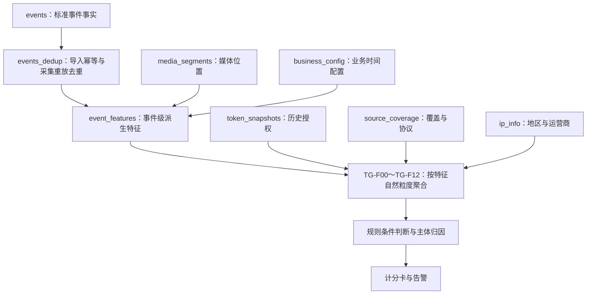

# TraceGuard 基础表与聚合特征抽取说明

本文依据当前仓库的六张隔离验证表、两个公共视图和 TG-F00～TG-F12 SQL，解释数据如何变成可供规则判断的特征。表结构见 [00_schema.sql](../sql/validation/00_schema.sql)，字段索引见 [特征提取 SQL 编号对照](特征提取SQL编号对照.md)。

当前实现处于验证层：六张 `da.tg_validation_*` 基础表承载测试事件与参考数据，两个视图是普通视图，特征 SQL 是按传入窗口执行的只读 SELECT。`extract_features.py` 将查询结果写入文件；目前没有在这些 SQL 中创建分钟、小时聚合结果表，也没有计算计分卡总分。本文最后的汇总建议不代表这些结果表已经建成。

## 1. 先理解整体关系

六张表中，`events` 是事实表，其余五张表提供解释事件所需的媒体、授权、采集、业务及网络信息。它们不是六份可以逐行相加的访问数据。



当前公共视图直接关联媒体表和业务配置表；授权快照、来源覆盖、IP 信息由需要它们的特征 SQL 另行读取。TG-F00 还会直接检查原始事件和来源覆盖。

三个标识要先分清：`run_id` 是验证批次，`scenario_id` 是验证场景，`user_id` 是租户账号。个人主体使用 `subject_type + subject_id`，不能用 `user_id` 代替观众。`VIEWER` 表示有认证依据的观众，`CREDENTIAL_VIEWER` 只是凭证绑定的观众，两者分别聚合。`dataset_kind` 标识合成、验收样例或脱敏参考数据，分析时需要明确选择范围。

## 2. 每张表的作用，以及如何参与聚合

下文表名均省略 `da.tg_validation_` 前缀。

### 2.1 events：记录实际观察到了什么

一条记录表示一次标准事件的采集记录，例如 TOKEN_CREATE、TS_VALIDATE、CDN_MEDIA_ACCESS 或 PLAYBACK_STATE。主要字段包括事件时间、事件类型、租户、观众身份依据、视频、token、会话、请求 IP、UA、鉴权结果、HTTP 结果、响应字节、播放状态及采样信息。

先去重，再按特征选择事件：

1. 对原表使用 `FINAL` 处理相同稳定 `record_id` 的重复导入。
2. `events_dedup` 再按 `run_id,event_id`，依 `ingest_time DESC,record_id DESC` 取一条，处理同一业务事件的采集重放。
3. 不同 `event_id` 的真实重试仍保留。不能按“相同 URL＋相同时间”直接删除。
4. 按 `[window_start,window_end)` 选择主统计窗口，再按个人、视频、token 或会话上下文分别聚合。

这张表提供计数、成功失败分母、去重集合、时序和区间的事件依据。`auth_result=1/0/-1` 分别表示 PASS/FAIL/UNKNOWN；UNKNOWN 单独统计。

同一次内容访问可能产生 TS 鉴权和 CDN 响应两条不同阶段记录。可以分别输出“鉴权通过量”和“有字节响应量”，不能将两者相加后称为实际访问请求量。`request_ref` 等关联信息用于保留请求上下文。

### 2.2 media_segments：把资源请求换成内容时间轴

该表解释一个 `object_path` 对应哪个视频、内容版本、清单、清晰度、音视频轨、分片序号及媒体区间。例如某个 TS 文件对应内容时间轴 `[60,66)` 秒。

当前公共视图的关联键是 `run_id,user_id,scenario_id,object_path`。验证契约要求该键只有一个媒体维度记录；表结构本身没有替业务强制这项唯一性。多条匹配会扩大事件行数，应先检查维度唯一性。

媒体映射后可计算两种不同的内容量：

- **请求等价媒体秒数**：对符合条件的请求累加 `segment_duration_s`，真实重复请求也累计。
- **唯一媒体秒数**：在同一 `video_id,content_version` 内，对 `[media_start_s,media_end_s)` 求区间并集，再跨不同内容求和。同一内容的不同清晰度或音视频轨，只有时间轴确认可对齐时才在这个层次去重。

它还提供唯一分片数、总片数与覆盖比例。分片规律需保留清单、清晰度、轨道等序列边界，不能把两条不同媒体序列的片号接起来。

没有媒体映射时，请求次数仍可观察，但内容秒数、内容覆盖及拉取速度应返回对应不可计算状态，不能假定“每片固定六秒”。

### 2.3 token_snapshots：回答事件发生时是否有权限

一条快照记录一个 token 在某个生效时点的授权视频集合、到期时间、撤销状态与策略版本，同时保留原签发和续期信息。

关联时先限定相同 `run_id,user_id,scenario_id,token_ref`，再对每条事件：

1. 找到 `effective_at <= event_time` 的最近快照。
2. 在选中的快照上检查是否撤销、是否过期。
3. 用事件的 `video_id` 检查是否属于 `allowed_video_ids`。
4. 最后按 token、事件阶段和统计窗口聚合有效、过期、撤销、范围外尝试、范围外鉴权通过和范围外响应数量。

不能先过滤过期或撤销的快照再选版本，否则可能错误退回较老的有效授权。也不能把某 token 的全部历史快照直接 JOIN 到事件后计数。

授权范围与凭证有效性是两个维度：一条请求可以“视频属于授权范围，但 token 已过期”。无历史快照时是 UNKNOWN，不等于范围外。

### 2.4 source_coverage：判断有没有足够数据支持结论

它记录某场景某事件类型在什么时间区间有完整采集、采样方法与比例，以及协议是否要求 token、清单、key、key 有效期和请求活跃 TTL。当前表没有独立 `source` 列，覆盖登记主要按批次、租户、场景、事件类型匹配；接入多个同类型来源时，须先明确覆盖登记如何区分它们。

它用于三类判断：

- **授权链路缺失**：没有看到 key，只能先说“未观察到”。只有协议要求 key，且回溯区间完整、未采样、有效期可判定时，才能判断必要步骤缺失。
- **活跃代理区间**：使用有依据的 `request_activity_ttl_seconds` 为请求构造活跃区间；模型必须覆盖窗口及必要回溯，缺失或冲突时不算代理并发。
- **历史基线**：没有事件的历史日，只有有完整覆盖证据时才可以按零活动参与基线；不能把停采日当成零。

这张表汇总的是有效覆盖区间及可计算条件，不是访问次数。多个区间应检查是否连续覆盖目标区间，不能把 `is_complete` 相加。各 SQL 的检查方式不同：当前 TG-F00 要求单条完整登记覆盖查询窗口，TG-F11 历史覆盖会计算有效区间并集。

已知、适用的概率采样可支持请求量估计，例如逐事件累加 `segment_duration_s / sampling_rate`。当前 TG-F03 仅在采样方法与单位满足约定时输出估计；唯一视频数、唯一媒体覆盖、序列顺序及并发不能统一乘以采样倒数。

### 2.5 business_config：确定业务时间和夜间口径

它记录租户场景的时区、夜间起止分钟、配置版本及有效区间。当前验证契约是每场景一个配置，公共视图先按 `run_id,user_id,scenario_id` 关联，再检查事件是否落在 `[valid_from,valid_to)` 内。

配置有效时生成 `local_hour`、`local_minute_of_day`、`is_off_hours`；再按主体、来源、事件类型、鉴权结果及采样口径汇总夜间事件量、活跃分钟、视频数、媒体量和夜间占比。

配置表本身不累加。以后允许同场景多版本时，要先按事件时点唯一选择有效版本，再关联；不能把每个配置版本都匹配到同一事件。历史比较还要检查历史与当前时区、夜间范围是否可比。

当前 SQL 仅支持 `Asia/Shanghai`；缺配置或不支持的时区会返回不可计算状态。

### 2.6 ip_info：为请求 IP 补充地区和运营商

它把 `request_ip` 映射成国家、省份、ISP 与映射版本。当前 TG-F07 在限定 `run_id` 后按请求 IP 整理映射，再关联主体的 TS 鉴权客户端事件。

聚合时按主体统计去重 IP、地区数、运营商数与已补齐映射的事件量；地区数应取集合基数，不能按 IP 行数直接相加。无 IP 映射时保留未知状态。

这张验证表中的地区和 ISP 是合成测试标签；生产中若要支持历史可重现，需要另行定义真实映射来源、版本和有效期。同一 IP 不等于同一个人，同一环境标签也不等于物理设备。

## 3. 按什么粒度抽取聚合特征

所有特征先固定租户、验证批次/场景和窗口。以下表中的主体及上下文是这些公共条件之外的分组维度；不是所有输出都能直接拼成一张同粒度宽表。

| 特征组 | 输入与主要用途 | 聚合粒度 | 主要计算 |
| --- | --- | --- | --- |
| [TG-F00](../sql/features/TG-F00_data_quality.sql) | 原始事件＋覆盖登记，检查数据前提 | 场景＋来源＋事件类型 | 物理量/业务量/重放量、解析与身份映射比例、未知比例、延迟分布、覆盖状态 |
| [TG-F01](../sql/features/TG-F01_single_event.sql) | 公共事件视图 | 单事件，不聚合 | 身份、环境、媒体位置、夜间、工具、鉴权与响应标签 |
| [TG-F02 / R1](../sql/features/TG-F02_authorization_chain.sql) | 事件＋授权快照＋覆盖协议 | 可靠会话；否则 token＋视频，并保留 token/video | 回溯前置步骤、三值存在性、不同缺失步骤数、可关联时间差 |
| [TG-F03 / R2](../sql/features/TG-F03_content_pull.sql) | TS 通过事件及 CDN 响应＋媒体位置 | 身份类型＋身份 ID；分别重算跨视频与视频局部 | 请求量、请求等价秒数、唯一内容区间、固定窗口拉取倍率 |
| [TG-F04 / R3](../sql/features/TG-F04_multi_video_activity.sql) | 请求事件、可信播放状态＋TTL 覆盖模型 | 身份类型＋身份 ID | 窗口活跃视频集合；视频播放区间重叠；独立输出请求活跃代理 |
| [TG-F05 / R4A](../sql/features/TG-F05_token_scope.sql) | 事件＋事件时点授权快照 | token＋事件类型 | 有效/过期/撤销量，范围外尝试/通过/响应量及视频集合 |
| [TG-F06 / R4B](../sql/features/TG-F06_token_environment.sql) | 客户端 TS 鉴权事件 | token | 环境/IP/UA 集合，环境首末观测、切换、返回和反复交错 |
| [TG-F07 / R5](../sql/features/TG-F07_subject_environment.sql) | 客户端 TS 鉴权事件＋IP 信息 | 身份类型＋身份 ID | 主体环境/IP/地区/ISP 集合、可确定顺序的环境切换 |
| [TG-F08 / R6](../sql/features/TG-F08_segment_pattern.sql) | TS 鉴权通过＋媒体序列 | 身份＋视频＋会话/token＋资源版本/清单/清晰度/轨道＋来源/采样 | 覆盖率、相邻片号递增、重复/回退、间隔均值/标准差/CV |
| [TG-F09 / R7](../sql/features/TG-F09_auth_failures.sql) | TS/key 鉴权事件 | 视频＋来源＋事件类型 | PASS/FAIL/UNKNOWN、失败率、失败 token/IP 集合、Top1 集中度 |
| [TG-F10 / R8](../sql/features/TG-F10_sustained_activity.sql) | TS 鉴权通过＋媒体位置 | 身份类型＋身份 ID＋来源/采样 | 活跃分钟集合、最长连续段、最大间隔、请求等价秒数与唯一媒体秒数 |
| [TG-F11 / R9](../sql/features/TG-F11_off_hours.sql) | 客户端事件＋业务配置＋历史覆盖 | 身份＋事件类型＋来源＋鉴权结果＋采样 | 夜间量/占比/活跃分钟，夜间媒体速度，同星期历史中位数及偏离 |
| [TG-F12 / R10](../sql/features/TG-F12_client_tools.sql) | 客户端工具标签 | 身份＋视频＋token＋会话 | 工具事件量、覆盖阶段数、签名证据、合法工具及后端事件排除量 |

按人展示的跨视频特征与某个视频的局部特征要分别计算。token 是授权与环境复用的重要上下文，去掉原型中的 token 计分卡 Tab 不影响这些内部特征的必要性；转入个人计分前仍需可靠归因。

视频失败属于视频异常，不能将同一个视频的失败分复制给所有观看者。TG-F11 单事件夜间标签不直接计风险分，SQL 与计分卡规则层分别负责特征和评分。

## 4. 用例：事件如何变成特征

### 4.1 内容拉取速度

假设一个 60 秒窗口内，同一认证观众访问同一视频：

- 请求 1：内容区间 `[0,6)`；
- 请求 2：内容区间 `[6,12)`；
- 请求 3：真实重试，再访问 `[0,6)`；
- 请求 4：另一清晰度访问 `[0,6)`，且已确认与前面是同一内容时间轴。

若四条均为 TS 鉴权通过，且媒体映射完整，则鉴权通过量为 4，请求等价媒体秒数为 24，但唯一媒体秒数只有 12。固定窗口鉴权唯一媒体速度为 `12 / 60 = 0.2`。

如果还有对应 CDN 记录，另算 CDN 响应媒体量及完整服务端输出媒体量，不将其与鉴权量相加。服务端响应也不能直接证明客户端实际观看。

### 4.2 视频失败率

同一视频、同一来源及同一鉴权阶段中，PASS=80、FAIL=20、UNKNOWN=30，则：

```text
已知结果数 = 80 + 20 = 100
失败率 = 20 / 100 = 20%
未知比例 = 30 / 130 ≈ 23.08%
```

未知既不当作失败，也不放入已知结果分母。Top1 失败来源占比的分母是全部失败事件，缺失 IP/token 另报未知量。

### 4.3 活跃视频与并发视频

窗口内先播放 A，再播放 B，可得到活跃视频数 2，但同时播放视频数仍可能为 1。只有可靠 PLAYING 区间实际重叠，才形成可信播放并发。仅有请求时可以计算请求活跃代理，但必须有明确 TTL 模型，并在字段名与状态中保留代理性质。

### 4.4 时序与环境

同 token 的环境序列 A→B→A 是返回；A→B→A→B 才构成反复交错证据。未知环境不创建伪设备，时间并列也不能用 event_id 排序冒充真实先后。

分片间隔 CV 为“请求间隔总体标准差 / 请求间隔均值”。当前实现至少需要三个请求且均值大于零；它解释已观察序列，不能在采样后还原真实全部间隔。

## 5. 如果要做分钟、小时、天汇总，哪些能合并

当前 SQL 可以直接对目标窗口执行。若后续为性能建立小窗口中间汇总，需要按统计性质保存可合并的数据，而不是只保存最终展示值。

| 统计类型 | 中间层应保留 | 合成大窗口的方法 | 不能怎么做 |
| --- | --- | --- | --- |
| 事件量、PASS/FAIL/UNKNOWN、字节量 | 同阶段、同口径的计数/总量 | 无重复且不重叠的时间桶相加 | 相加重叠窗口，或混加鉴权与 CDN 量 |
| 失败率、覆盖率等比例 | 分子、分母及未知量 | 先合并分子分母，再重算比例 | 平均各分钟比例 |
| 平均值 | 有效样本数与和 | 合并和与样本数后重算 | 不加权平均各桶均值 |
| 去重视频/IP/环境/分钟数 | 原始集合或适用的可合并去重状态 | 集合并集后计算基数 | 相加各桶 distinct 数 |
| 唯一媒体秒数 | 按视频/内容版本分开的媒体区间或可合并区间状态 | 合并区间再求并集长度 | 相加各桶唯一秒数；同一内容可能跨桶重复 |
| Top1 来源集中度 | token/IP 对应的失败次数分布 | 合并频数分布，再取最大值除以失败总数 | 平均各桶 Top1 占比 |
| 最长连续活跃段 | 分钟集合，或首尾连续段、边界和内部最大段 | 处理相邻桶边界后重算 | 只对各桶最长段取 max |
| 环境切换、分片序列及间隔 | 有序明细或充分的序列边界/内部状态 | 处理跨桶相邻事件后重算；复杂交错优先保留事件依据 | 相加桶内切换、平均桶内 CV |
| 并发与重叠秒数 | 截断规则明确的有效状态/活跃区间 | 统一边界后求重叠 | 用活跃视频数替代并发，或相加各桶最大并发 |
| P95、中位数及历史基线 | 原始样本或适用的可合并分位状态 | 合并同口径样本/状态后计算 | 平均各桶 P95 或中位数 |

这里的可合并状态是后续实现建议，并非当前已建表。计分阈值使用什么窗口，特征就按什么窗口解释；不能把八天累计值套入十分钟阈值。

24 小时占比还须满足窗口条件。当前 TG-F10 仅在窗口恰好为 86400 秒且起点对齐分钟时输出 `*_24h` 和活跃分钟 `/1440`，否则给出状态，不把短窗口假装成全天。

## 6. 建议的抽取顺序与结果管理

1. **固定查询范围与口径。** 明确租户、事件时间窗口、测试批次/场景、数据类别、事件阶段、身份范围与采样方式。
2. **去重并检查维度基数。** 读取 `events_dedup`，检查媒体及业务配置匹配唯一性；保存未映射与未知数量。
3. **生成单事件标签。** 使用 `event_features` 获得身份、可信环境、媒体位置、夜间和响应事实；TG-F00 同步报告数据前提。
4. **按特征补齐历史。** 授权快照和前置 key 可早于窗口起点，播放状态需读取有效前态，夜间基线需历史窗口；均不能读取窗口结束后的事实来判断过去。
5. **按自然粒度分别运行 TG-Fxx。** 个体跨视频、视频局部、视频整体、token 和会话结果分别保存。若需要拼宽表，先明确每组向目标粒度归并的规则，避免一对多结果直接 JOIN 扩增。
6. **保留数值、质量和证据。** 除特征值外保留分子分母、未知量、窗口、身份范围、可计算状态及原因；局部特征状态优先，不能只看全组 AVAILABLE。
7. **再做规则与计分。** 根据主体归因和上下文选择可准入的证据，按计分卡进行同事实去重、分组封顶等；不要将 TG-F 每个输出字段都当成独立加分项。

若以后持久化特征结果，建议统一标识 `feature_group/feature_version`、租户、主体类型与 ID、上下文维度、窗口和抽取时点，并保留 `compute_status/reason_code/value_kind`。当前文件间的组号、版本与时点字段尚未完全统一，不能假定已有统一结果表契约。

当前 `scripts/extract_features.py` 对 TG-F01 只输出声明的 100 行样本，其余组按传入窗口执行聚合；脚本输出 PASS 表示该查询执行成功，业务正确性和性能仍要结合相应验收证据判断。本文基于仓库静态 SQL 解读，没有访问数据库或新增生产汇总表。
